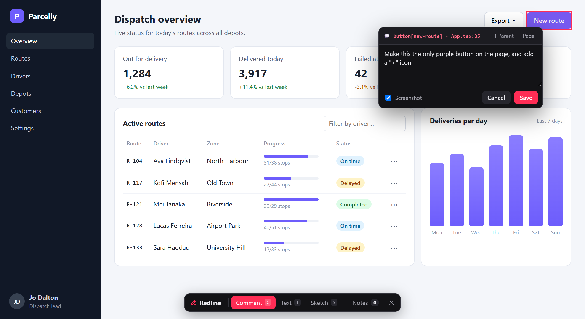
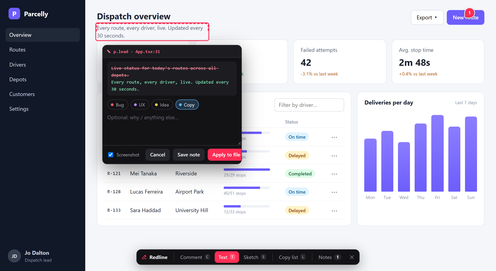
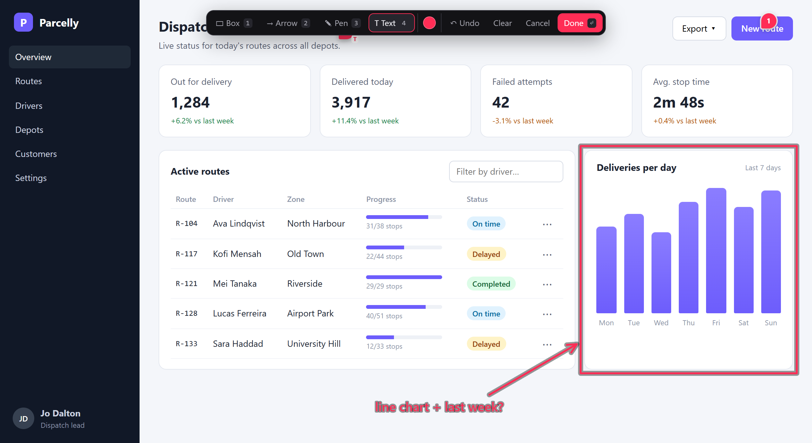
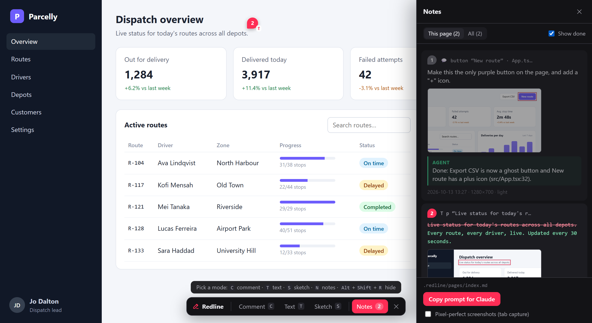

# Redline

**Mark up a running web UI, and let an AI agent apply the changes.**



Redline is a dev-only overlay for any web app. Press **Alt+Shift+R** in the browser, then pin
comments on elements, rewrite text in place, or sketch on the page. Each note is saved by the
dev server as markdown under `.redline/` with everything an agent needs to find the code:
- the URL
- a CSS selector and XPath
- the test id
- the **source file:line** and the **component chain**
- the viewport and theme
- recent console errors
- a screenshot with the target outlined

An agent works through the notes with the bundled `redline` skill. It ticks each note off and
replies inline, and the replies show up live in the overlay.

It works with Vite, SvelteKit, Astro and React, and was built on real apps in each of them. Nothing ships to production: the plugin only runs under `vite dev` / `astro dev`.

## Modes

| Key | Mode | What you do | What's saved |
|---|---|---|---|
| `C` | **Comment** | Click an element and type. `Alt`+click picks its parent, `Shift`+click comments on the whole page. Use **↑ Parent** to widen the target. | The instruction plus element context and a cropped screenshot |
| `T` | **Text** | Click any text and edit it in place. `Enter` keeps the edit. | A `diff` block (`-` old / `+` new) plus an optional note |
| `S` | **Sketch** | Draw with box `1`, arrow `2`, pen `3` and text `4`. `Ctrl+Z` undoes, `Enter` finishes. | The SVG plus a viewport screenshot with the sketch drawn on top |
| `N` | **Notes** | Open the panel: this page or all pages, done/reopen, edit, delete, agent replies, and **Copy prompt for Claude**. | |
| `Esc` | | Steps back one level: draft → mode → panel → closed. | |

Clicks never reach the app while you're picking. Notes show as numbered pins that follow their
element, and hovering a pin shows the note and the agent's reply.

| Text: edit in place, saved as a diff | Sketch: box, arrow, pen and labels |
|---|---|
|  |  |



<sub>Screenshots are from the fictional demo app in [`examples/demo`](examples/demo). Run it with `npm run demo`;
regenerate the images with `npm run screenshots`.</sub>

## Setup in a repo

```bash
npm install -D @umage.ai/redline
npx redline init        # skill in .claude/skills/redline, .redline/ in .gitignore, a CLAUDE.md note
```

**Vite / React** (`vite.config.ts`). Put Redline first, before the framework plugin:

```ts
import redline from '@umage.ai/redline/vite'

export default defineConfig({ plugins: [redline(), react()] })
```

**SvelteKit**: the same, placed before `sveltekit()`.

**Astro** (`astro.config.mjs`). It only activates under `astro dev`:

```js
import redline from '@umage.ai/redline/astro'

export default defineConfig({ integrations: [redline()] })
```

**Other Node dev servers**: `@umage.ai/redline/server` exports `redlineMiddleware()` → `{ api, inject }`.

**Working on Redline itself**: build a checkout (`npm run dev`) and `npm link` it, or import
`<checkout>/dist/vite.js` directly from the app's config.

Options: `redline({ root, dir: '.redline', hotkey: 'alt+shift+r', launcher: true, jsxSource: true })`.
- `root` is where notes go and what source paths are relative to. It defaults to the nearest folder with `.git`.
- Set `launcher: false` to hide the small round button and rely on the hotkey only.

## What gets written

```
.redline/
  INDEX.md               page → open/done counts (regenerated on every change)
  pages/<page>.md        one file per URL path
  assets/<id>.png|svg    screenshots and sketches
```

```markdown
### [ ] Comment · `button` “Next” · src/components/LoginForm.tsx:48
<!-- redline {"id":"…","type":"comment","url":"http://localhost:5173/login","target":{"selector":"div > form > button",
  "source":{"file":"src/components/LoginForm.tsx","line":48,"col":9},"components":["LoginForm"],…},"viewport":[1366,860,1],"theme":"dark",…} -->

Make this full-width on mobile only.


> Added `sm:w-auto`; full width below 640px (LoginForm.tsx:48).
```

The markdown is the source of truth. Every write from the overlay re-reads the file first,
so an agent's ticks and replies are never overwritten. The overlay polls about every 2 s,
which is why replies appear without a reload.

## How source locations are found

| Stack | Source of `file:line` | Components |
|---|---|---|
| Svelte 5 / SvelteKit | `__svelte_meta` (built into Svelte dev builds) | `__svelte_meta.parent` chain |
| Astro | `data-astro-source-file/-loc` (snapshotted at parse time, because Astro's dev toolbar strips them) | `.astro` files up the tree |
| React 19 (Vite) | The plugin stamps `data-redline-src="file:line:col"` on HTML elements in `.jsx`/`.tsx` during dev | Fiber owner chain, with router and provider plumbing filtered out |
| Anything else | n/a | n/a. The selector, test id and text still identify the element. |

## Screenshots

By default the DOM is rendered to a canvas with
[modern-screenshot](https://github.com/qq15725/modern-screenshot). Page scroll and inner scroll
containers are reproduced. WebGL canvases, cross-origin map tiles and video may come out blank
this way. For those apps, tick **Pixel-perfect screenshots (tab capture)** in the panel. It
captures the real tab pixels, and Chrome asks once per page load.

## Develop

```bash
npm run dev         # rebuild dist/ on change (reload the app for client changes, restart it for server changes)
npm test            # unit tests (node:test) + docs check
npm run test:e2e    # Playwright against fixture apps: vanilla, React, SvelteKit, Astro
npm run check       # typecheck + unit + docs + e2e
npm run test:package   # install the packed tarball into fresh apps per framework and test it end to end
npm run smoke -- <url> "<selector>"   # pin a throwaway note on any running app
```

Releasing: bump `version` in `package.json`, push, and publish a GitHub release tagged `v<version>`.
[`publish.yml`](.github/workflows/publish.yml) runs every check and publishes to npm through Trusted Publishing.

Contributor and agent guidance is in [CLAUDE.md](CLAUDE.md). Project state, decisions and learnings
are in [docs/](docs/STATE.md).

## Roadmap

See [docs/STATE.md](docs/STATE.md#next-up).

## License

[MIT](LICENSE)
