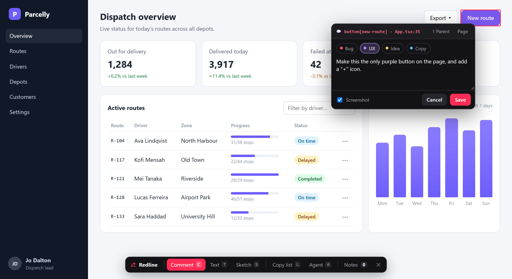
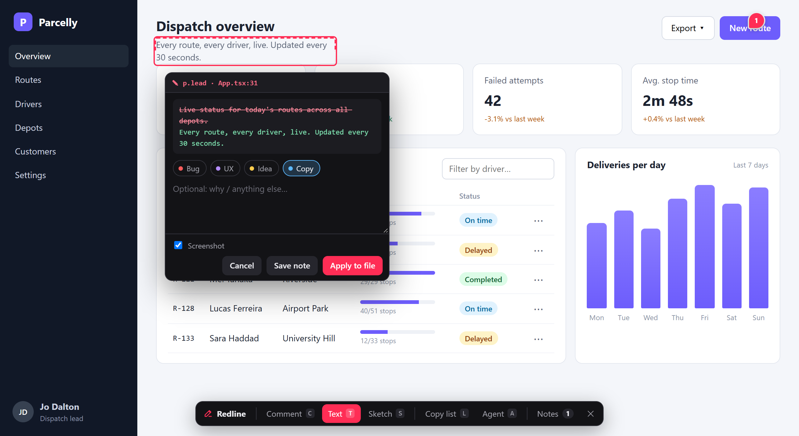
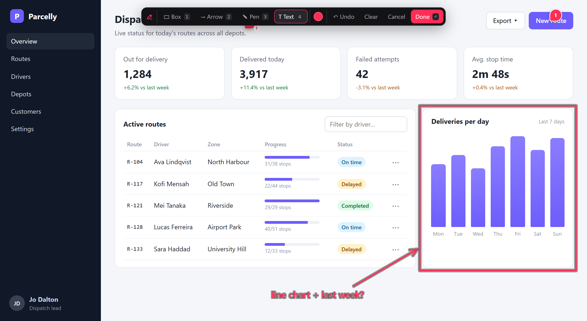
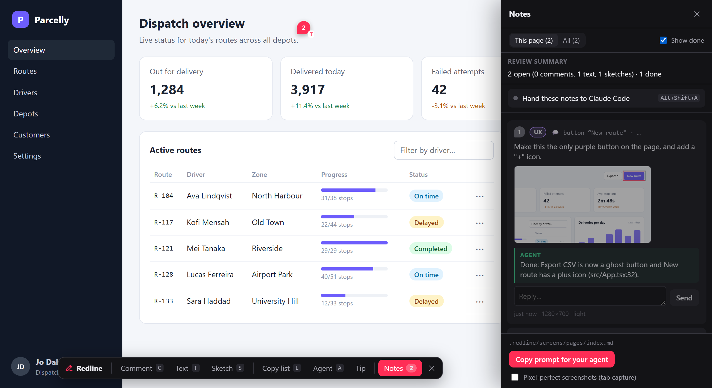
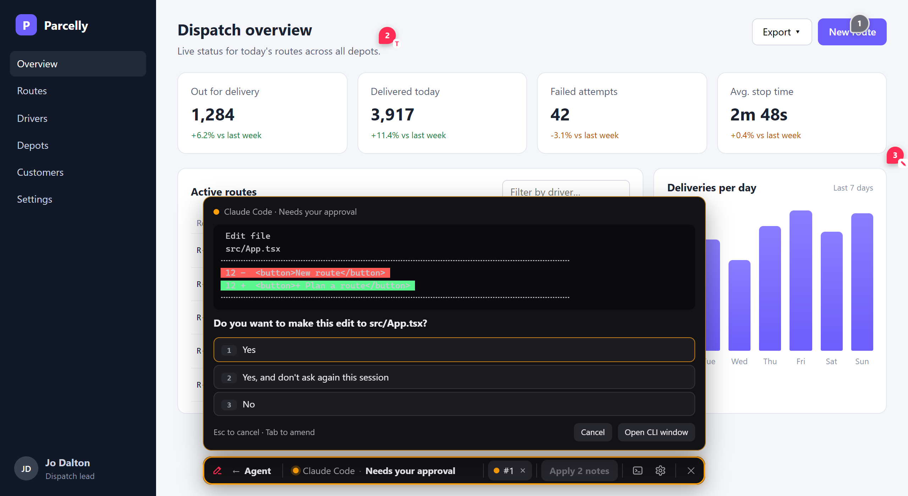

<h1 align="center">Redline</h1>
<p align="center"><b>Mark up a running web UI, and let an AI agent apply the changes.</b></p>
<p align="center"><a href="https://www.npmjs.com/package/@umage.ai/redline"></a> <a href="https://github.com/umage-ai/redline/blob/main/LICENSE"></a></p>
<p align="center"><a href="https://umage.ai/products/redline"><b>Product page</b></a> · <a href="#packages">Packages</a> · <a href="#quick-start">Setup</a> · <a href="https://github.com/umage-ai/redline/blob/main/docs/SETUPS.md">Setups</a> · <a href="https://github.com/umage-ai/redline/blob/main/docs/USAGE.md">Guide</a> · <a href="https://github.com/umage-ai/redline/releases">Releases</a></p>



Redline is a dev-only overlay for any web app. Press **Alt+Shift+R** in the browser, then pin comments on elements,
rewrite text in place, or sketch on the page. Any coding agent (Claude Code, Codex, Cursor, Copilot, Gemini CLI, …)
then works through the notes, ticks each one off and replies inline, and the replies show up live in the overlay.
It works with React, Vue, Svelte/SvelteKit, Solid, Preact and Astro on Vite, Next.js 15+, Angular 17+ and any Node
server, with ASP.NET Core, Blazor and Optimizely coming as NuGet packages. Nothing ships to production: it only runs in
the dev server (`vite dev`, `astro dev`, `next dev`, `ng serve`, Debug builds), unless you opt in for a review site.

## How it works

1. **Pin.** A reviewer comments on an element, edits its text or sketches over the page, on desktop or phone.
2. **Saved as markdown.** The dev server writes each note to `.redline/` with what an agent needs to find the code: the URL,
   selector, XPath and test id, the **source file:line** and **component chain**, viewport and theme, recent console errors,
   and a screenshot with the target outlined ([what gets written](https://github.com/umage-ai/redline/blob/main/docs/USAGE.md#what-gets-written)).
3. **The agent applies it.** `npx redline init` installs the `redline` guide for your agent (or use the
   [MCP server](https://github.com/umage-ai/redline/blob/main/docs/USAGE.md#mcp-server)); **Copy prompt for your agent** in the notes panel hands it the open notes.

| Text: edit in place, saved as a diff | Sketch: box, arrow, pen and labels |
|---|---|
|  |  |

## Quick start

```bash
npm install -D @umage.ai/redline
npx redline init        # agent guide + AGENTS.md section, .redline/ in .gitignore
```

**Vite** (React, Vue, Svelte/SvelteKit, Solid, Preact): put Redline first in `vite.config.ts`, before the framework plugin.

```ts
import redline from '@umage.ai/redline/vite'

export default defineConfig({ plugins: [redline(), react()] })   // or vue(), sveltekit(), solid(), preact()
```

Run `vite dev` and press **Alt+Shift+R**. Other stacks ([full setup per framework](https://github.com/umage-ai/redline/blob/main/docs/FRAMEWORKS.md)):

| Stack | Setup |
|---|---|
| Astro | `integrations: [redline()]` from `@umage.ai/redline/astro` (only under `astro dev`) |
| Next.js 15+ | `withRedline(nextConfig)` from `@umage.ai/redline/next` + `<Redline />` in the root layout |
| Angular 17+ | the `@umage.ai/redline:dev-server` builder for `serve` in `angular.json` |
| Other Node servers | `redlineMiddleware()` → `{ api, inject }` from `@umage.ai/redline/server` |
| ASP.NET Core, Blazor, Optimizely (upcoming) | `AddRedline()` ([dotnet/README.md](https://github.com/umage-ai/redline/blob/main/dotnet/README.md)) |

The API under another path (`apiBase`, a .NET `PathBase`), on another origin (`cors`, credentials or a header hook) or the overlay
inside iframes (`allowInIframe`): [docs/SETUPS.md](https://github.com/umage-ai/redline/blob/main/docs/SETUPS.md).
Local dev, shared notes, a deployed review site or your own backend: [docs/SETUPS.md](https://github.com/umage-ai/redline/blob/main/docs/SETUPS.md) says which fits.
Every option and its default: [docs/OPTIONS.md](https://github.com/umage-ai/redline/blob/main/docs/OPTIONS.md).

## Keys

| Key | Mode |
|---|---|
| `C` | **Comment**: click an element and type (`Alt`+click: its parent, `Shift`+click: the whole page) |
| `T` | **Text**: edit any text in place; saved as a diff, or written to the file with **Apply to file** |
| `S` | **Sketch**: box `1`, arrow `2`, pen `3`, text `4`; `Enter` finishes |
| `N` | **Notes**: the panel with every note, agent replies and **Copy prompt for your agent** |
| `Esc` | One step back: draft → mode → panel → closed |

Labels, phones, the launcher and your own open buttons, screenshots, direct edit and more: [docs/USAGE.md](https://github.com/umage-ai/redline/blob/main/docs/USAGE.md).



## Agent panel

With `@umage.ai/redline-agent` and `agent: true`, your agent CLI runs from the overlay: **Apply 2 notes**, its questions and
diffs in a card on the toolbar, a session per prompt, and its state as a ring on the launcher. Every installed CLI is offered
(Claude Code, OpenCode; ⚙ picks one, with its model and effort); OpenCode and any other [ACP](https://agentclientprotocol.com) agent run over the Agent Client
Protocol, so their permission prompts arrive with their real options. Local dev only. See [agent/README.md](https://github.com/umage-ai/redline/blob/main/agent/README.md).



## Packages

Start with the core; add the others only when you need them. Each has its own README.

| Package | Version | What it is | Add it when |
|---|---|---|---|
| [`@umage.ai/redline`](https://www.npmjs.com/package/@umage.ai/redline) | [](https://www.npmjs.com/package/@umage.ai/redline) | The core: dev-server plugins (Vite, Astro, Next.js, Angular, any Node server), the overlay, the agent skill, the MCP server and the CLI | Always: this is Redline ([setup](#quick-start)) |
| [`@umage.ai/redline-agent`](https://www.npmjs.com/package/@umage.ai/redline-agent) | [](https://www.npmjs.com/package/@umage.ai/redline-agent) | Your agent CLI run from the overlay: the agent toolbar, fresh sessions, its questions in a card ([agent/](https://github.com/umage-ai/redline/blob/main/agent/README.md)) | You want notes applied without opening a terminal (local dev) |
| [`@umage.ai/redline-hub`](https://www.npmjs.com/package/@umage.ai/redline-hub) | [](https://www.npmjs.com/package/@umage.ai/redline-hub) | A shared note server for a team: projects, members, live notes ([hub/](https://github.com/umage-ai/redline/blob/main/hub/README.md)) | Several people review the same app |
| [`@umage.ai/redline-overlay`](https://www.npmjs.com/package/@umage.ai/redline-overlay) | [](https://www.npmjs.com/package/@umage.ai/redline-overlay) | The overlay as browser modules, no server parts ([overlay/](https://github.com/umage-ai/redline/blob/main/overlay/README.md)) | You embed Redline in your own product (an extension, a review site) |

## Learn more

- [docs/FRAMEWORKS.md](https://github.com/umage-ai/redline/blob/main/docs/FRAMEWORKS.md): setup per framework, monorepos, how source locations are found
- [docs/USAGE.md](https://github.com/umage-ai/redline/blob/main/docs/USAGE.md): the modes in full, coding agents and MCP, what gets written, extending and embedding
- [docs/SETUPS.md](https://github.com/umage-ai/redline/blob/main/docs/SETUPS.md) · [docs/OPTIONS.md](https://github.com/umage-ai/redline/blob/main/docs/OPTIONS.md) · [docs/PROTOCOL.md](https://github.com/umage-ai/redline/blob/main/docs/PROTOCOL.md) (remote stores) · [skill/SKILL.md](https://github.com/umage-ai/redline/blob/main/skill/SKILL.md) (the agent's guide)
- Working on Redline: [CLAUDE.md](https://github.com/umage-ai/redline/blob/main/CLAUDE.md) has every command; [docs/USAGE.md](https://github.com/umage-ai/redline/blob/main/docs/USAGE.md#develop) covers testing and releasing.

<sub>Screenshots are from the fictional demo app in [`examples/demo`](https://github.com/umage-ai/redline/tree/main/examples/demo) (`npm run demo`; regenerate with `npm run screenshots`).</sub>

## License

[MIT](https://github.com/umage-ai/redline/blob/main/LICENSE)
