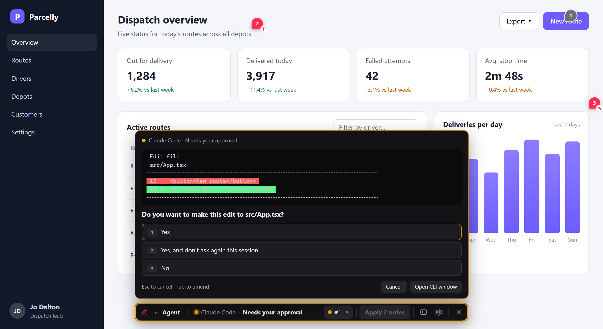

<h1 align="center">Agent bridge</h1>
<p align="center"><b>Drive agent CLIs (Claude Code, OpenCode, any other) from a browser: sessions, live status, their questions as data.</b></p>
<p align="center"><i>Not published yet: it lives in the Redline repo while its API settles.</i></p>
<p align="center"><a href="#quick-start"><b>Quick start</b></a> · <a href="#features">Features</a> · <a href="https://github.com/umage-ai/redline/blob/main/agent-bridge/PROTOCOL-7501.md">OSC 7501</a> · <a href="https://github.com/umage-ai/redline/blob/main/agent/README.md">Redline's agent panel</a> · <a href="https://github.com/umage-ai/redline/blob/main/docs/DECISIONS.md">Decisions (D63)</a></p>



`@umage.ai/agent-bridge` runs agent CLIs on a Node server, in a pseudo-terminal or over the
[Agent Client Protocol](https://agentclientprotocol.com), and gives a browser everything it needs to drive them: one
guarded HTTP handler, a status feed, and a small client. It knows nothing about Redline; Redline's agent panel is built on it.

## Quick start

```js
// server.mjs
import http from 'node:http';
import { createBridge } from '@umage.ai/agent-bridge';

const bridge = createBridge({ root: process.cwd(), sessions: 'fresh', worktrees: true });
http.createServer((req, res) => {
  const { pathname } = new URL(req.url, 'http://x');
  if (pathname.startsWith('/agent/')) return bridge.handle(req, res, pathname.slice('/agent'.length));
  res.end('<script type="module" src="/app.js"></script>');
}).listen(3000, '127.0.0.1');
```

```js
// app.js (served from the same origin)
import { bridgeClient } from '@umage.ai/agent-bridge/client';

const agents = await bridgeClient('/agent');
agents.watch(group => render(group.sessions));          // every session's state, live
const { id } = await agents.send('Fix the failing test', { cli: 'claude-code' });
// a session asks (a permission prompt, a question): its menu is in session.prompt; answer it
await agents.choose(id, 0);
```

A CLI of your own reports its status with the emitter: `programStatus({ app: 'my-cli' }).working('Reading files')`
(`@umage.ai/agent-bridge/emit`; the protocol: [PROTOCOL-7501.md](https://github.com/umage-ai/redline/blob/main/agent-bridge/PROTOCOL-7501.md)).

## Features

| | |
|---|---|
| **Sessions** | A pseudo-terminal (node-pty) or ACP over stdio; one shared session or a new one per prompt, several at once; kept across a host's handler restarts |
| **Adapters** | Claude Code and OpenCode built in (model, effort, instructions, menus); any other command runs generically; add your own |
| **Status** | OSC 7501 reports (the bridge answers the probe and DA1 in order), ACP turns, or output activity as the fallback |
| **Questions as data** | Claude Code's menus read off a headless screen (permission prompts with their diff, stepped questions); ACP permission requests with the agent's own options |
| **Worktrees** | Optional: each new session on its own branch and folder; keep, merge (clean only) or discard when it ends |
| **Attachments** | Per prompt: files changed (git snapshots), ACP resource links, OSC 8 links, mentioned files; served from inside the project only |
| **MCP for sessions** | Hand your MCP servers to the sessions you start (Claude Code `--mcp-config`, ACP `session/new`), with the session's id |
| **Guards built in** | This machine only (loopback peer and Host), foreign Origin refused, a per-process token on every call; a host can narrow them, never widen them |

## Routes

Relative to where you mount the handler: `GET /info` (sessions, CLIs, the token), `GET /stream?status=1&token=` (the
feed), `GET /stream?id=&token=` (one session's output), `POST /send`, `/start`, `/choose`, `/answer`, `/input`,
`/resize`, `/ack`, `/mode`, `/end`, `/stop`, `/worktrees`, `/worktree`, `/attach` (header `x-agent-token`), and
`GET /attachments`, `/file`, `/diff` (`?token=`). The types are in [`src/types.ts`](https://github.com/umage-ai/redline/blob/main/agent-bridge/src/types.ts).

It imports nothing from Redline (a test checks), so it can move to a repo of its own once a second project uses it.
MIT licensed.

---

Part of **Redline** ([umage.ai/products/redline](https://umage.ai/products/redline)): [all packages](https://github.com/umage-ai/redline#packages), [source](https://github.com/umage-ai/redline).
