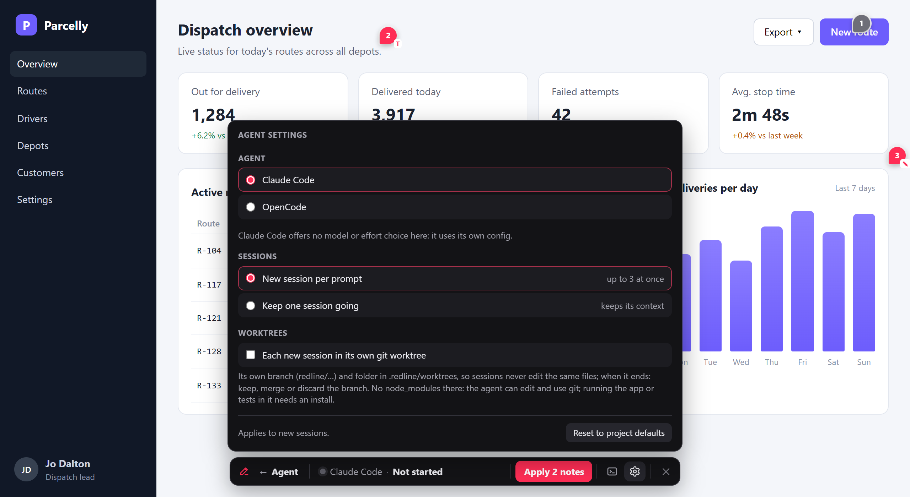
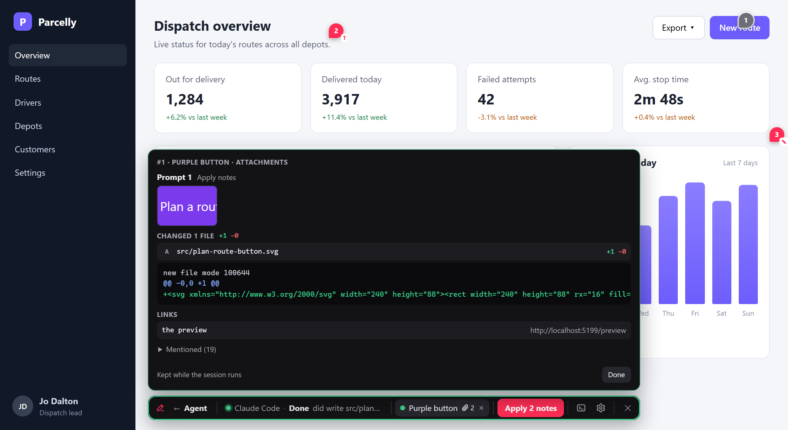

<h1 align="center">Redline agent</h1>
<p align="center"><b>Your agent CLI, run from the Redline overlay: apply notes, answer its questions, see what it changed.</b></p>
<p align="center"><a href="https://www.npmjs.com/package/@umage.ai/redline-agent"></a> <a href="https://github.com/umage-ai/redline/blob/main/LICENSE"></a></p>
<p align="center"><a href="#quick-start"><b>Quick start</b></a> · <a href="#features">Features</a> · <a href="#options">Options</a> · <a href="https://github.com/umage-ai/redline/blob/main/docs/USAGE.md#agent-panel">Guide</a> · <a href="https://github.com/umage-ai/redline#packages">All packages</a></p>


Reviewers pin notes with [Redline](https://github.com/umage-ai/redline); this package runs your agent CLI (Claude Code,
OpenCode, any terminal program, any [ACP](https://agentclientprotocol.com) agent) on the dev server and drives it from
the overlay. **Apply 3 notes**, answer its permission prompts in a card, and see the files it changed, without opening a terminal.

## Quick start

```bash
npm i -D @umage.ai/redline @umage.ai/redline-agent
```

```js
redline({ agent: true })   // in vite.config (or Astro, Next, Angular, the Node server): every installed CLI is offered
```

Open the app, press **Alt+Shift+A** (or **A** in Redline's toolbar), pin a note, press **Apply 1 note**. node-pty comes with
it (prebuilt on Windows and macOS, compiled on Linux; without build tools: `npm i -D @lydell/node-pty`).

## Features

| | |
|---|---|
| **The agent toolbar** | **← Agent**, the state ("Claude Code · Working…"), a tab per session (named by its notes), **Apply N notes**, **>_** the CLI window, **⚙** settings |
| **Questions in a card** | Permission prompts with their diff, Claude Code's stepped questions, trust dialogs: every option, and a field for your own answer. ACP agents send theirs as data |
| **Several CLIs** | Every installed one is offered; ⚙ or holding **Apply** switches; model and effort per CLI (only values the CLI offers reach it) |
| **Fresh sessions** | A new session per prompt with only its notes, several at once; or one shared session that keeps its context |
| **Worktrees** | ⚙ **Each new session in its own git worktree**: its own branch, `redline/<name>`; when it ends, keep, merge (clean only) or discard it |
| **Attachments** | A 📎 count on each tab: per prompt, the files it changed (with the diff), images, files and links it pointed at |
| **MCP wired in** | Sessions it starts get Redline's MCP: `working_on` tags the note being worked on, `attach` shows a file on the tab, `note_dom` and `page_console` read the open page |
| **Live status** | From the CLI's OSC 7501 reports or the ACP session: a sweeping light while it works, orange while it waits for you, green when done; a ring on the closed launcher too |



Local dev only: it answers this machine only (whatever Redline's `network` option says), every call needs a per-process
token, and the CLI keeps its own permission prompts.

## Options

```js
redline({ agent: 'opencode' })           // one CLI by name, no picker
redline({ agent: { clis: ['claude', 'opencode', { command: 'codex', label: 'Codex' }] } })   // the CLIs offered
redline({
  agent: {
    command: 'claude', args: ['--permission-mode', 'acceptEdits'],
    model: 'opus', effort: 'high',        // defaults for ⚙ (Claude Code --model/--effort; ACP: the agent's options)
    commands: [{ label: 'Review page', prompt: 'Review page {page} against the open Redline notes {ids}' }],
    sessions: 'fresh', maxSessions: 3,    // a new session per prompt (the default; 'shared': one session)
    worktrees: true,                      // each new session in its own git worktree (default off; ⚙ switches)
    instructions: { file: 'redline-agent.md' },  // your rules for the sessions Redline starts
    hotkey: 'alt+shift+a', key: 'a',      // false for none
  },
})
```

Or hand it over yourself, typed: `import { agent } from '@umage.ai/redline-agent'; redline({ agent: agent({ command: 'codex' }) })`.
Every option and its default: [docs/OPTIONS.md](https://github.com/umage-ai/redline/blob/main/docs/OPTIONS.md#agent-umageairedline-agent-d53).

Prompts fill in `{page}`, `{url}` and `{ids}` (the open notes on the page no running session has); a prompt with `{ids}`
shows their count and tags those notes in the notes panel (sent, being worked on, waiting for you, done).
`instructions` (text, or `{ file }` read at every start) reach Claude Code as `--append-system-prompt-file`, any other CLI
ahead of its first prompt.

### Worktrees

With **Each new session in its own git worktree** on (⚙, or `worktrees: true`), a fresh session works in
`.redline/worktrees/<name>` on the branch `redline/<name>`, so parallel sessions never edit the same files. The tab's
hover names the branch. When the session ends, the card offers **Keep branch**, **Merge into <your branch>** (a
fast-forward or a clean merge, never forced; uncommitted work must be committed first) or **Discard** (asks first when
that would drop work). The worktree has no node_modules: the agent edits and commits there; to run the app or tests in
it, install first. Not a git repo: the switch is off and says why.

### Attachments



A 📎 count on a tab opens what that session pointed at, per prompt, most reliable first: what the agent attached (MCP
`attach`, an ACP agent's resource links and tool-call files), the files that changed in the turn (git, with +/− and the
diff), links the CLI marked (OSC 8), and, folded, files and URLs its output merely mentioned. Images open zoomed; links
on this machine open in a new tab; nothing is fetched by the server, and files are served only from inside the project.

### MCP

Sessions the toolbar starts get Redline's MCP (`/__redline/mcp`) wired in: Claude Code through `--mcp-config`, an ACP agent
through `session/new`, with their own token and session id (`REDLINE_AGENT_SESSION`). Besides the note tools they get
`working_on` (the note it is on: its tag and the tab say so), `attach`, `note_dom` and `page_console` (from the open page),
`check_page`, and `list_agent_sessions` / `get_agent_session` to see what other sessions are doing.

### Several CLIs, adapters, ACP

Hold **Apply** (500 ms; or right-click, Alt+↓, Shift+F10) to switch the CLI for the next prompt; the pick is remembered in
this browser. With one shared session, a prompt for another CLI stops it between turns and starts the new one.
What is particular to a CLI sits in an adapter: Claude Code (menus read off its screen, `--model`, `--effort`, instructions as
a file) and OpenCode (over ACP by default). Add your own, tried first:

```js
import { agent, openCode } from '@umage.ai/redline-agent';
redline({ agent: agent({ command: 'opencode', adapters: [{ ...openCode, settleMs: 2000 }] }) })
```

ACP agents run without a terminal: status and permission requests arrive as data (the card shows "Allow once", "Always
allow", "Reject"), the CLI window shows a transcript and takes typed prompts. Any other ACP agent:
`{ command: 'my-acp-agent', protocol: 'acp' }`. OpenCode asks before nothing by default; to approve from the card, set
`"permission": { "bash": "ask", "edit": "ask" }` in its config (or `env: { OPENCODE_CONFIG_CONTENT: '…' }` for Redline's sessions only).

## How it is built

The generic part, driving agent CLIs from a browser (sessions, adapters, OSC 7501, menu reading, worktrees, attachments,
one guarded HTTP handler), is [`agent-bridge/`](https://github.com/umage-ai/redline/blob/main/agent-bridge/README.md),
bundled into this package; this package adds the toolbar and Redline's notes. Decisions:
[D53, D55, D56, D58, D59, D62–D66](https://github.com/umage-ai/redline/blob/main/docs/DECISIONS.md). MIT licensed.

---

Part of **Redline** ([umage.ai/products/redline](https://umage.ai/products/redline)): [all packages](https://github.com/umage-ai/redline#packages), [source](https://github.com/umage-ai/redline).
