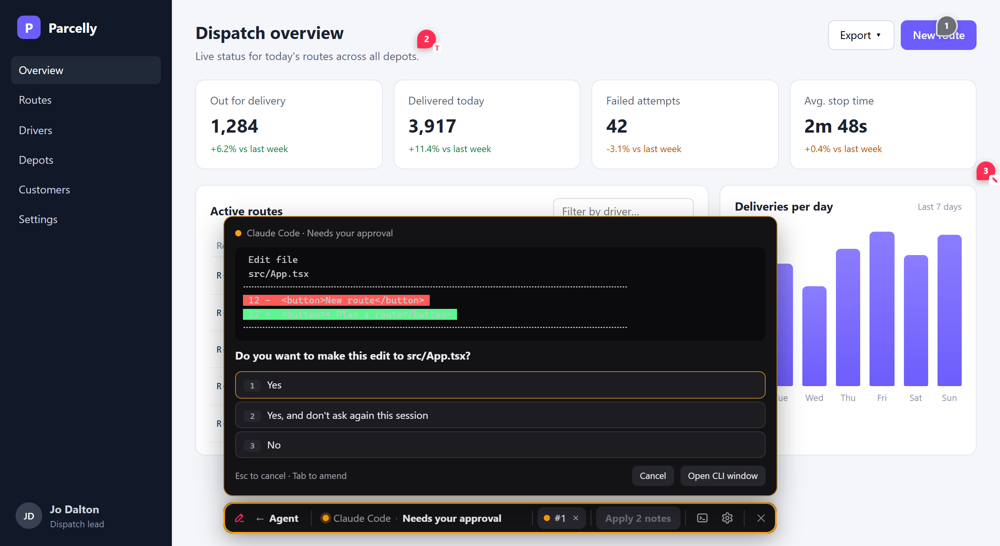

# @umage.ai/redline-agent

The agent panel for [Redline](https://github.com/umage-ai/redline)'s dev server. It runs your agent CLI
(Claude Code, OpenCode, or any terminal program; any [ACP](https://agentclientprotocol.com) agent without a terminal) on the dev
server and drives it from the overlay, so reviewers never need to open a terminal:



- **The agent toolbar**: **Agent** (A) in Redline's toolbar, or `Alt+Shift+A` from anywhere. Left to right:
  **← Agent** (back to Redline's toolbar; Esc too), the state with the CLI's name ("Claude Code · Working…") and its
  own message, a tab per session, **Apply 3 notes** (your other prompt buttons behind ⋯), **>_** for the CLI window
  (xterm.js), **⚙** for your settings, and ✕ (closes the overlay).
- **Its questions in a card** on the toolbar: when the CLI shows a menu (a permission prompt with its diff, Claude Code's
  stepped questions, a trust dialog), the card shows the context, the question and every option, with a field for
  "Type something". It is read off the CLI's screen, so it is exactly what the terminal shows; a click moves the
  CLI's cursor and presses Enter. This is for Claude Code (detected from its OSC 7501 reports or the command
  `claude`). ACP agents (OpenCode by default) send their permission requests as data, so the card shows their own
  options too; other CLIs get **Allow**/**Deny** and the terminal (`menus: true` tries it anyway).
- **Settings (⚙)**, kept in this browser: the CLI (with several installed), its model and effort (Claude Code's
  aliases `fable`, `opus`, `sonnet` and `--effort low…max`; an ACP agent's own lists, asked once in the background),
  and a new session per prompt or one kept going. They apply to new sessions; **Reset to project defaults** forgets
  them. The server passes on only values from the lists it offered.
- **Several CLIs**: every installed one is offered. Hold **Apply** (or right-click it, or Alt+↓ / Shift+F10 on it) to
  switch the CLI for the next prompt; nothing runs until you press it.
- **Live status** from the CLI's OSC 7501 reports (Claude Code sends them) or the ACP session: a light sweeping round the toolbar
  and a turning ring on the closed launcher while it works, an orange glow while it waits for you, green when done.
- **Fresh sessions** (the default since 0.10; ⚙ switches): every prompt starts its own session with only its notes
  (none that a running session already has), several at once, a tab each, named by its first note: a dot for its
  state (working, waiting for you, done and not yet seen in bold; seen and ended ones fade to the right), the CLI's
  initials while two CLIs are in use, the prompt, notes, model and last message on hover, × to end it (it asks first
  while the agent works). 3 tabs show, the rest behind **+N** (a list of every session); on phones one session button
  opens it. `sessions: 'shared'` keeps one session that keeps its context; either way a note goes to one running session at a time.
- **The CLI window** (>_): the session's terminal, or its transcript over ACP; its header names the session, — minimizes
  it (the session runs on), **End session** stops the CLI and closes the session.
- **The notes panel** tags each note it was sent: being worked on, waiting for your answer, sent, or done.

Local dev only: it answers this machine only (whatever Redline's `network` option says), and every call needs a
per-process token. The CLI keeps its own permission prompts.

## Install

```bash
npm i -D @umage.ai/redline @umage.ai/redline-agent
```

node-pty comes with it (an optional dependency: prebuilt on Windows and macOS, compiled on Linux). Linux without
build tools: `npm i -D @lydell/node-pty` instead.

## Use

Turn it on with Redline's `agent` option, in any setup (Vite, Astro, Next, Angular, the Node server):

```js
redline({ agent: true })                 // every installed one of claude, opencode: ⚙ picks (below)
redline({ agent: 'opencode' })           // one CLI by name, no picker (any CLI runs; see Adapters below)
redline({ agent: { clis: ['claude', 'opencode', { command: 'codex', label: 'Codex' }] } })   // the CLIs offered
redline({
  agent: {
    command: 'claude', args: ['--permission-mode', 'acceptEdits'],
    model: 'opus',                        // the default model (Claude Code --model; ACP: the agent's model option)
    effort: 'high',                       // the default effort (Claude Code --effort; ACP: its thought_level option)
    commands: [{ label: 'Review page', prompt: 'Review page {page} against the open Redline notes {ids}' }],
    keys: { allow: '\r', deny: '\x1b' },  // what Allow / Deny send (Claude Code's prompt)
    hotkey: 'alt+shift+a',
    key: 'a',                             // the Agent button's key in the toolbar; false when an extension uses A
    sessions: 'fresh', maxSessions: 3,    // a new session per prompt (the default; 'shared': one session)
    instructions: { file: 'redline-agent.md' },  // or a string; see below
  },
})
```

Redline finds this package in your project. Or hand it over yourself (typed, and bundler-friendly):

```js
import { agent } from '@umage.ai/redline-agent';
redline({ agent: agent({ command: 'codex' }) })
```

### Several CLIs

With more than one CLI (`agent: true` with Claude Code and OpenCode both installed, or a `clis` list), ⚙ lists them,
and holding **Apply** (500 ms; or right-click, Alt+↓, Shift+F10) opens a quick switch (arrow keys and Enter work too).
Your pick is remembered in this browser and named on Apply's tooltip; each session runs the CLI it was started with (OpenCode over ACP) and its tab says which. With Fresh,
sessions of different CLIs run side by side; with one shared session, a prompt for another CLI stops the shared
one (between turns, not while it works or asks; its tab stays, ended) and starts the new one. `clis` takes adapter ids or commands
(`'claude'`, `'opencode'`, with the option's `args`), any other command, or `{ command, args, label, id, env }`;
the installed ones are offered, the first is the default. A `command` alone means just that CLI.

### Adapters

What is particular to a CLI sits in an adapter (`AgentAdapter`): Claude Code (menus read into the card,
`--model` and `--effort` with the `models` and `efforts` ⚙ offers, instructions as `--append-system-prompt-file`) and OpenCode (over ACP by default, below; in a
terminal with `protocol: 'pty'`: status from its OSC 7501 reports, Allow/Deny for its prompts). Any other CLI
runs as is: Allow/Deny, the terminal, and 7501 status if it sends it. Add or tune your own, tried before the built-in ones:

```js
import { agent, openCode } from '@umage.ai/redline-agent';
redline({ agent: agent({ command: 'opencode', adapters: [{ ...openCode, settleMs: 2000 }] }) })
// ⚙'s lists for a CLI of yours, passed to `start` (only these values ever reach it):
const mine = { id: 'mine', name: 'My CLI', command: 'my-cli', matches: c => c === 'my-cli',
  models: ['small', { value: 'large', name: 'Large' }], efforts: ['low', 'high'],
  start: o => ({ args: [...o.args, ...(o.model ? ['--model', o.model] : []), ...(o.effort ? ['--effort', o.effort] : [])] }) };
```

### ACP mode

Agents that speak the [Agent Client Protocol](https://agentclientprotocol.com) run without a terminal
(`protocol: 'acp'`; OpenCode does by default, as `opencode acp`). Redline talks JSON-RPC to them over stdio:
working while a prompt runs, done when it returns, and a permission request shows in the card with the agent's
own options ("Allow once", "Always allow", "Reject"); Cancel ends the turn. The CLI window shows a transcript
(the agent's text, tool calls, its plan) and a line typed there is sent as a prompt. `model` and `effort` are set
through the agent's config options (`model`, `thought_level`; OpenCode: `provider/model`, as in `opencode models`); ⚙
lists what the agent offers, asked once in the background when the toolbar loads (OpenCode answers in about a
second); `instructions` go ahead of the first prompt. Any other ACP agent: `{ command: 'my-acp-agent', args: [...], protocol: 'acp' }`. Claude Code stays in
the terminal (its ACP mode is a separate adapter package).

OpenCode asks before nothing by default. To approve its shell commands and edits from the card, set
`"permission": { "bash": "ask", "edit": "ask" }` in OpenCode's config, or for Redline's sessions only:
`env: { OPENCODE_CONFIG_CONTENT: '{"permission":{"bash":"ask","edit":"ask"}}' }`.

Prompts fill in `{page}`, `{url}` and `{ids}` (the open notes on the page); a prompt with `{ids}` shows their count
and tags those notes "sent". Prompts wait until the CLI is ready for input.

`instructions` adds your own rules to the sessions Redline starts, on top of the project's CLAUDE.md / AGENTS.md
(say "don't commit", "run the tests for the files you touch"). Text, or `{ file }` relative to the project root,
read at every start. Claude Code gets it as `--append-system-prompt-file`; any other CLI ahead of the session's
first prompt. The agent starts in the project root (where `.redline/` is), or `cwd`.

How it works and why: [D53, D55, D58, D59, D62](https://github.com/umage-ai/redline/blob/main/docs/DECISIONS.md). MIT licensed.

---

Part of **Redline** ([umage.ai/products/redline](https://umage.ai/products/redline)): [all packages](https://github.com/umage-ai/redline#packages), [source](https://github.com/umage-ai/redline).
