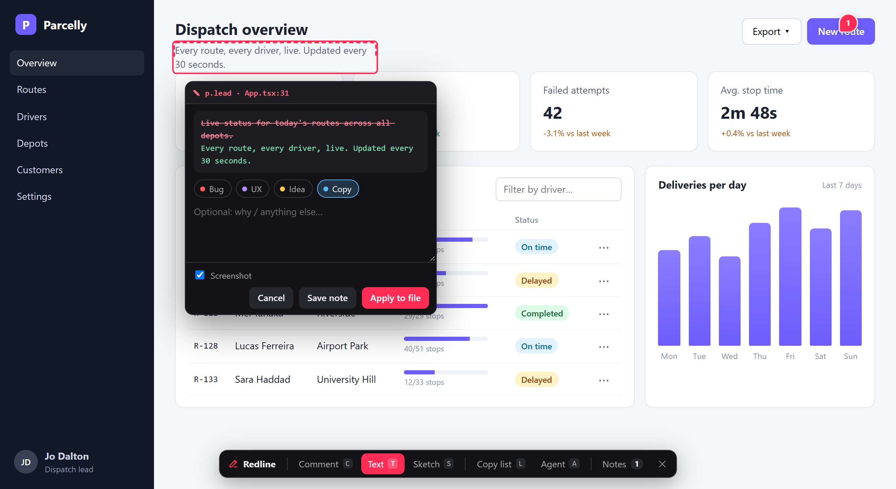
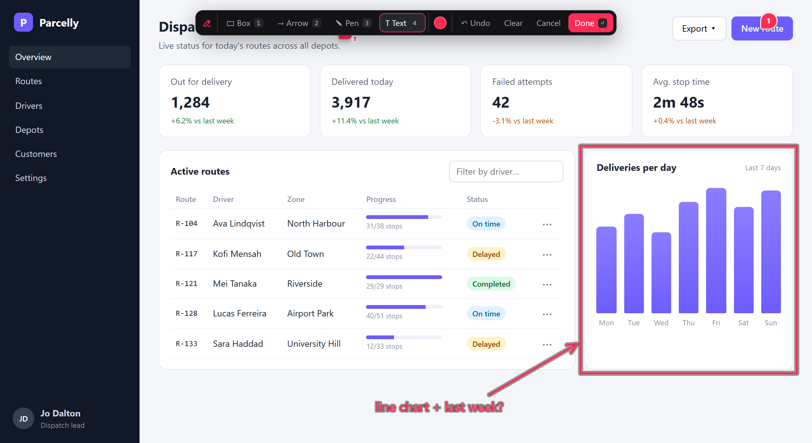
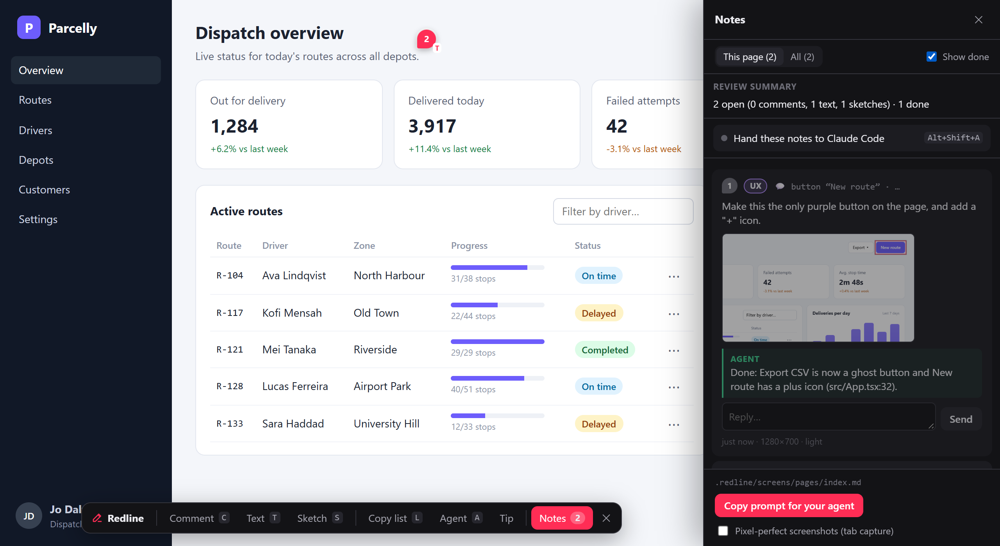

# Using Redline

Last updated: 2026-11-11 · Cap: 200 lines · The reviewer's features, coding agents and MCP, the note files, extending and embedding.

Setup per framework: [FRAMEWORKS.md](FRAMEWORKS.md). Every option and its default: [OPTIONS.md](OPTIONS.md).

## Modes

| Key | Mode | What you do | What's saved |
|---|---|---|---|
| `C` | **Comment** | Click an element and type. `Alt`+click picks its parent, `Shift`+click comments on the whole page. Use **↑ Parent** to widen the target. | The instruction plus element context and a cropped screenshot |
| `T` | **Text** | Click any text and edit it in place. `Enter` (or clicking outside) keeps the edit. | A `diff` block (`-` old / `+` new) plus an optional note |
| `S` | **Sketch** | Draw with box `1`, arrow `2`, pen `3` and text `4`, in six colours (tap the colour dot to fold out the palette, or `C` to cycle). `Ctrl+Z` undoes, `Enter` finishes. | The SVG plus a viewport screenshot with the sketch drawn on top |
| `N` | **Notes** | Open the panel: this page or all pages, done/reopen, edit, delete, agent replies, and **Copy prompt for your agent**. | |
| `Esc` | | Steps back one level: draft → mode → panel → closed. | |

Saving a note returns to idle; press `C` (or tap **Comment**) for the next one. Clicks never reach the app while you're
picking, and the app never sees you using the overlay, so an open dropdown, popover or combobox stays open: open it,
press `C` and click the item (try the **Export** menu, **⋯** row menus and driver filter in `npm run demo`). Notes show
as numbered pins that follow their element; hovering a pin shows the note and the agent's reply.

**Labels.** Tag a note from the chips above the text box (**Bug**, **UX**, **Idea**, **Copy**), or start it with `#bug`.
The label leads the note's heading, so the agent sees it first. Your own: `labels: ['Bug', { name: 'Perf', color: '#0c0' }]`;
none: `labels: false`; `labels` may also be a function of the request.

**Phones and tablets** work too: open the app over your LAN (`vite --host`), tap the launcher, then the mode buttons.
Toolbars grow their targets, a tap picks while a swipe scrolls, the popover stays above the keyboard and the panel goes
full width. **↑ Parent** / **Page** replace `Alt`/`Shift`+click. Reaching the dev server from a phone, Docker or nginx:
[SETUPS.md](SETUPS.md#reaching-the-dev-server-from-elsewhere).

| Text: edit in place, saved as a diff | Sketch: box, arrow, pen and labels |
|---|---|
|  |  |



## Launcher and toolbar

`launcherSize: 'small' | 'medium' | 'large'` (26, 32 or 40 px; or a number) sizes the round button; its bubble counts the
open notes on the page. `launcherPosition` moves it off an app's own bottom-right button: `'bottom-left'`, `'top-right 24'`
or `'bottom-center 16 80'` (px from the edges, x then y), or `{ x, y, offsetX, offsetY }` (.NET `LauncherPosition`).
`draggable` (on by default since 0.10; `false` pins them) lets each reviewer move the launcher (drag it), the toolbar and
the sketch tools (drag their icon; at phone width only up and down); the browser remembers where, and double-clicking an
icon puts them back.

`launcher: false` hides the round button: open with the hotkey or your own button, no script needed, in any framework or
Razor view: `<button data-redline-open>Review</button>` toggles; `="comment"`, `"text"`, `"sketch"`, `"notes"`, `"open"`,
`"close"` pick what. From script: `(window.redlineExtensions ||= []).push(rl => { myBtn.onclick = () => rl.open(); })`;
with `mount()`, `rl.api.open()` and `data-<namespace>-open`.

## Options in brief

`redline({ root, dir: '.redline', hotkey: 'alt+shift+r', launcher: true, draggable: true, labels: [...], jsxSource: true, vueSource: true })`.
`root` is where notes go and what source paths are relative to (default: the nearest folder with `.git`). `app` names the
app in a monorepo (default: the dev server's folder, e.g. `apps/web`). `pageKey: 'path'` makes hash routes (a deck's `#/3`)
share one notes file. `prompt` replaces the **Copy prompt** text (`{open}`, `{page}`), or `false` hides it (the default
with a remote store). The overlay and its API answer this machine only; **`network`** adds addresses, subnets and host
names (`['192.168.1.20', '172.17.0.1', 'myapp.test']`), or `true` for everyone (a deployed review server that gates
reviewers itself; `redlineMiddleware` answers this machine only too, since 0.10).

## Screenshots

By default the DOM is rendered to a canvas with [modern-screenshot](https://github.com/qq15725/modern-screenshot), page
scroll and inner scroll containers included. WebGL canvases, cross-origin map tiles and video may come out blank this way.
For those apps, tick **Pixel-perfect screenshots (tab capture)** in the panel: it captures the real tab pixels, and
Chrome asks once per page load.

## Coding agents

Redline isn't tied to one agent. The notes are plain markdown, and `npx redline init` installs the guide
([skill/SKILL.md](../skill/SKILL.md)) where agents look for it:

| Written | Read by |
|---|---|
| `.agents/skills/redline/SKILL.md` (always) | Agent Skills: Codex, Cursor, GitHub Copilot / VS Code, OpenCode, … |
| a Redline section in `AGENTS.md` (always; created if missing) | Codex, Cursor, Copilot, Windsurf, Zed, Amp, Jules, Devin, Factory, … |
| `.claude/skills/redline/SKILL.md` + a `CLAUDE.md` section pointing at it | Claude Code (the skill also shows up as `/redline`) |
| a `GEMINI.md` section + `.gemini/commands/redline.toml` | Gemini CLI (`/redline`) |
| `.github/prompts/redline.prompt.md` | Copilot Chat in VS Code (`/redline`) |

The last three are added when the repo already uses that agent (`CLAUDE.md` or `.claude/`, `GEMINI.md` or `.gemini/`,
`.github/copilot-instructions.md`…), or when you ask: `npx redline init --agents=claude,gemini` (`all` / `none` work too).
Re-running `init` refreshes the guide after an upgrade. In a terminal, `init` lists the changes and asks first (`--yes`
skips the question); `--dry-run` only lists them.

**Copy prompt for your agent** in the notes panel copies a ready prompt, e.g. *Apply the open Redline notes in
.redline/pages/settings.md (3 open). Follow .agents/skills/redline/SKILL.md.* Without `init`, the prompt spells out the
note format itself, so any agent can work from it.

### MCP server

Optional: `npx redline init --mcp` registers `redline mcp` (`.mcp.json`, plus VS Code, Gemini, Cursor) with `list_notes`,
`get_note` (with the screenshot) and `update_note`. It goes through the running dev server, so a custom `store` works;
without one it reads `.redline/`. Codex: `codex mcp add redline -- npx -y @umage.ai/redline mcp`. The dev server also
serves the tools over HTTP at `/__redline/mcp` (local callers; `mcpTokens: ['…']` lets bearer-token agents in from
elsewhere; through `next dev` too).

### Agent panel

Local dev: `agent: true` (Claude Code or OpenCode, whichever is installed; or a command such as `'opencode'`, or
`{ command, args, model, effort, commands: [{ label, prompt }], keys, hotkey, sessions, instructions, adapters }`) runs your
agent CLI from the overlay without opening a terminal: **Agent** (A), or `Alt+Shift+A` from anywhere, opens the agent
toolbar: **← Agent** (back to the main toolbar; Esc too), the state ("Claude Code · Working…"), a tab per session named
by its notes (× ends it, asking first while the agent works or waits on you), **Apply 3 notes** (your other prompt buttons
behind ⋯; `{page}`, `{ids}`), **>_** for the CLI window (**End session** in its header, — minimizes it while the session
runs on), **⚙** and ✕. A card on the toolbar shows whatever the agent asks (an edit with its diff, Claude's stepped
questions, Allow/Deny) with every option and a field for your own answer; the notes panel tags the notes it is working
on, waiting on you for, was sent and has done. **⚙** holds this browser's settings: the CLI (with several installed;
holding Apply, right-click or Alt+↓ switches it too), its model and effort (Claude Code's aliases and `--effort` levels,
an ACP agent's own list), and a new session per prompt (the default since 0.10: only its notes, several at once) or one
kept going (`sessions: 'shared'`); they apply to new sessions, and Reset goes back to the project's options. With
**Each new session in its own git worktree** (⚙, or `worktrees: true`) a fresh session works on its own branch,
`redline/<its name>`, in `.redline/worktrees/`, so parallel sessions never touch the same files; when it ends you keep the
branch, merge it (only a fast-forward or a clean merge) or discard it (asked first when that drops work). The worktree has
no node_modules: the agent edits and commits there; to run the app or tests in it, install first.
`instructions: { file: 'redline-agent.md' }` adds your own rules to the sessions Redline starts. Its state comes
from the CLI's OSC 7501 status, on the toolbar's outline and as a ring around the closed launcher: a light sweeping round
it while working, an orange glow while it waits for your approval, green when done (hover says what it is doing), which
Claude Code reports. It is its own package: `npm i -D @umage.ai/redline-agent` ([agent/README.md](../agent/README.md);
node-pty comes with it). It runs on this machine only, with the CLI's own permission prompts.

## What gets written

`.redline/INDEX.md` (open/done counts per page, regenerated on every change), `pages/<page>.md` (one file per URL path)
and `assets/<id>.png|svg` (screenshots and sketches). A note:

```markdown
### [ ] Comment · `button` “Next” · src/components/LoginForm.tsx:48
<!-- redline {"id":"…","type":"comment","url":"http://localhost:5173/login","target":{"selector":"div > form > button",
  "source":{"file":"src/components/LoginForm.tsx","line":48,"col":9},"components":["LoginForm"],…},"viewport":[1366,860,1],"theme":"dark",…} -->

Make this full-width on mobile only.


> Added `sm:w-auto`; full width below 640px (LoginForm.tsx:48).
```

The markdown is the source of truth. Every write from the overlay re-reads the file first, so an agent's ticks and
replies are never overwritten. The overlay polls about every 2 s, which is why replies appear without a reload. The full
contract agents follow: [skill/SKILL.md](../skill/SKILL.md).

## Extending

All optional; without them Redline behaves as described above. Types come from `@umage.ai/redline/server`.

- **`directEdit`** (on by default in the dev-server plugins since 0.10; `false` turns it off): the text popover gets
  **Apply to file** when the edited text is static in source (Astro, Svelte, JSX, Vue, Angular templates, plain `.html`).
  Inline markup such as `<b>` and links is kept as written; Ctrl+B / Ctrl+I add it. Entities stay as the file wrote them
  (`&mdash;`); repeated text on a static page is told apart by position. Expressions like `{t('title')}`, components and
  rendered or translated text are refused with the reason, and you save a note as usual. `[myWriter(), ...defaultWriters()]`
  adds your own writers (i18n files, a CMS).
- **`store`**: a `NoteStore` (`version`, `list`, `create`, `update`, `remove`, `asset`, optional `subscribe`) or
  `({ root, dir, app }) => store`. **`remoteStore({ url, token })`** (or `REDLINE_STORE_URL`/`_TOKEN`) shares notes
  through a hosted store, live, with authors and resolved notes in green ([PROTOCOL.md](PROTOCOL.md));
  `npx @umage.ai/redline-hub` runs one, with projects, tokens, MCP and a UI ([hub/README.md](../hub/README.md)).
- **`hooks`**: `onCreate`, `onUpdate`, `onRemove`, `onSourceWrite`. **`buildSource: true`** keeps source stamps in
  `vite build` (a review build behind `redlineMiddleware`); **`build`** records the commit.
- **`extensions`**: browser ES modules that add toolbar buttons (with keys), panel sections and event listeners. A file
  path is served as plain JS; `{ url: '/src/redline.ext.ts' }` lets Vite compile it, or push onto `window.redlineExtensions`.
  API v2: `removeButton`, `panelState()` + `panel` event, `setPageKey(fn)` + `page` event; v3: `addSlot`, `gate`;
  v4: `beforeSave`, card decorators and actions, `setPinStyle`, `addMode`, `addSketchTool`, and the
  `error`/`noteUpdated`/`noteRemoved`/`messageSent` events; v5: `addToolbar` (your own toolbar in place of the main one,
  with a hotkey), `addWindow` (a floating window), `setStatus` (the toolbar's outline or a dot, and a ring or dot on the
  closed launcher) with the `status` event, and `setBadge` (the launcher bubble: open notes by default).
- **Embedding** (an extension, another product): `mount(opts)` from `@umage.ai/redline/overlay` or
  `@umage.ai/redline-overlay`, with your own transport, note statuses and threads, a sign-in gate and translated UI text
  ([SETUPS.md](SETUPS.md#embedding-the-overlay-in-your-product), [overlay/README.md](../overlay/README.md)).

## Develop

`npm run dev` rebuilds on change, `npm test` runs the unit tests and the docs check, `npm run check` everything (with
Playwright against every framework fixture), `npm run test:package` installs the packed tarballs into fresh apps.
Releasing: on an up-to-date `main`, `npm run release -- patch` (or `minor`, `major`, `x.y.z`) bumps, tags `v<version>` and
pushes; [`publish.yml`](../.github/workflows/publish.yml) runs every check, publishes via Trusted Publishing and creates
the release. Contributor guidance and every command: [CLAUDE.md](../CLAUDE.md). State, decisions, learnings and
roadmap: [STATE.md](STATE.md#next-up).
