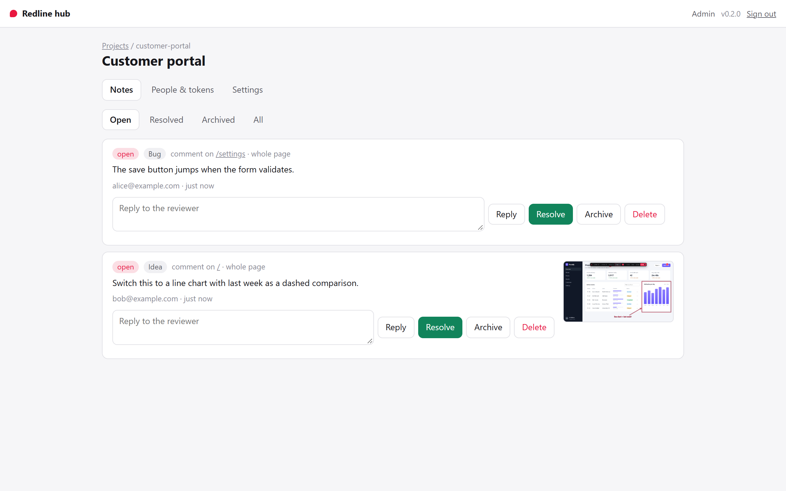

<h1 align="center">Redline hub</h1>
<p align="center"><b>One shared place for a team's Redline notes: live, per project, with an MCP endpoint for agents.</b></p>
<p align="center"><a href="https://www.npmjs.com/package/@umage.ai/redline-hub"></a> <a href="https://github.com/umage-ai/redline/blob/main/LICENSE"></a></p>
<p align="center"><a href="#quick-start"><b>Quick start</b></a> · <a href="#features">Features</a> · <a href="#sharing-it-with-a-team">Sharing it</a> · <a href="https://github.com/umage-ai/redline/blob/main/docs/SETUPS.md">Where to run it</a> · <a href="https://github.com/umage-ai/redline#packages">All packages</a></p>



By default every [Redline](https://github.com/umage-ai/redline) dev server keeps notes as markdown in its own checkout.
Point several at a hub and everyone reviewing the app sees the same notes, live: who filed what, replies, and a green
pin when a note is resolved. One file, no dependencies, Node 22.13 or later.

## Quick start

```bash
npx @umage.ai/redline-hub
```

```
  Redline hub 0.3.0  http://127.0.0.1:4780
  Data: /home/me/redline-hub.db

  Admin key (shown once; keep it):  rha_…
  Sign in:  http://127.0.0.1:4780/#key=rha_…
```

Open the sign-in link, create a project, then add a token per reviewer under **People & tokens**.
The token is shown once, with what to paste:

```bash
# the reviewer's dev server environment (the Redline Vite/Astro/Angular/Node plugin reads these)
REDLINE_STORE_URL=http://127.0.0.1:4780/p/customer-portal
REDLINE_STORE_TOKEN=rht_…

# an agent
claude mcp add --transport http redline http://127.0.0.1:4780/p/customer-portal/mcp \
  --header "Authorization: Bearer rht_…"
```

The browser never sees the token: the dev server makes the calls, and the overlay keeps talking to
its own `/__redline`. ASP.NET Core apps use `o.UseRemoteStore(url, token)`.

## Features

| | |
|---|---|
| **Projects** | Each its own set of notes, with optional **allowed sites**: notes filed from any other page are refused, so nobody files from production by mistake |
| **Personal tokens** | Per project: a token acts as one person, whose name goes on their notes. Agent tokens are for MCP only |
| **MCP per project** | `/p/<project>/mcp`: `list_notes`, `get_note`, `update_note`. An agent closing a note resolves it, and the reviewer's pin turns green |
| **A web UI** | Manage projects and tokens, read notes with their screenshots, reply, resolve, reopen, archive |
| **One SQLite file** | On Node's built-in `node:sqlite`; tokens and keys stored as SHA-256 hashes only |

It implements the [remote store protocol](https://github.com/umage-ai/redline/blob/main/docs/PROTOCOL.md), so nothing about it
is special to the overlay: any server that speaks the protocol works the same way. Where it fits among the ways to run
Redline: [SETUPS.md](https://github.com/umage-ai/redline/blob/main/docs/SETUPS.md) (setups 2 and 4).

## Options

| Option | Default | |
|---|---|---|
| `--port <n>` | `4780` | `0` picks a free port |
| `--host <addr>` | `127.0.0.1` | anything else warns: see below |
| `--db <file>` | `./redline-hub.db` | plus its `-wal`/`-shm` files |
| `--public-url <url>` | from host and port | the address others reach it on, for links and setup snippets |

`redline-hub reset-admin` prints a new admin key; the old one and its sessions stop working.

## Sharing it with a team

The hub binds to localhost: by default only your machine can reach it. That is enough for
several dev servers on one machine, or a teammate who connects through an SSH tunnel.

To share it on a network, start it with `--host 0.0.0.0` and it warns you, because:

- it speaks **plain HTTP**: put HTTPS in front (a reverse proxy such as Caddy, or a tunnel), and pass
  `--public-url https://…` so links and snippets use that address;
- it has **no SSO, rate limits or backups**: tokens are the only gate. Keep it on a private
  network or VPN, and back up the `.db` file if the notes matter;
- **screenshots show whatever was on the reviewer's screen.** Use allowed sites to keep notes to
  the environments you mean.

It is a reference implementation for teams, not a hardened product. For editors on a live site, the
.NET package's online mode is built for that (roles, SQL store, site tokens).

## Notes on behaviour

- **Resolved notes** (done in the UI, by an agent, or from the overlay) stay on the reviewer's page in
  green until about 5 minutes after their author has seen them, and at most 24 hours. They stay in
  the hub's UI under *Resolved*.
- **Archive** takes a note off every page without deleting it. **Delete** removes it and its screenshot.
- **Signing in** takes the admin key (everything) or a member token (that project's notes only).
- Tokens, the admin key and sessions are stored as SHA-256 hashes only.

MIT licensed. Decision [D44](https://github.com/umage-ai/redline/blob/main/docs/DECISIONS.md).

---

Part of **Redline** ([umage.ai/products/redline](https://umage.ai/products/redline)): [all packages](https://github.com/umage-ai/redline#packages), [source](https://github.com/umage-ai/redline).
