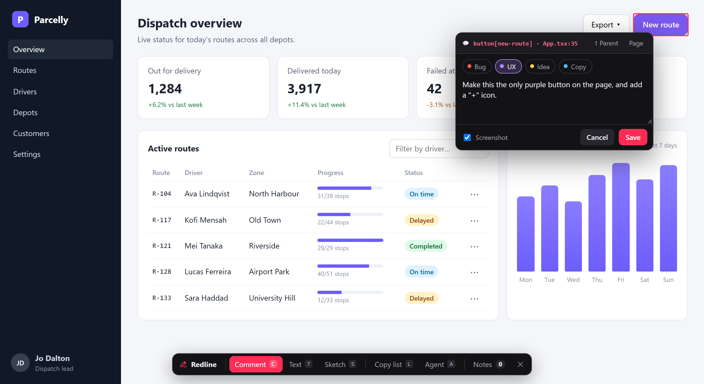

<h1 align="center">Redline overlay</h1>
<p align="center"><b>The Redline review overlay as browser modules, for products that embed it.</b></p>
<p align="center"><a href="https://www.npmjs.com/package/@umage.ai/redline-overlay"></a> <a href="https://github.com/umage-ai/redline/blob/main/LICENSE"></a></p>
<p align="center"><a href="#quick-start"><b>Quick start</b></a> · <a href="#features">Features</a> · <a href="https://github.com/umage-ai/redline/blob/main/docs/SETUPS.md#embedding-the-overlay-in-your-product">Embedding guide</a> · <a href="https://github.com/umage-ai/redline#packages">All packages</a></p>



Reviewers pin comments, text changes and sketches on the live page; your code decides where the notes go. For a browser
extension, a review site, a snippet on a customer's page. No server parts, no dependencies, nothing runs on import. The
dev-server integrations (Vite, Astro, Next, Angular, Node, .NET) are in [`@umage.ai/redline`](https://www.npmjs.com/package/@umage.ai/redline),
which ships the same modules as `@umage.ai/redline/overlay`.

## Quick start

```bash
npm i @umage.ai/redline-overlay
```

```js
import { mount, httpTransport } from '@umage.ai/redline-overlay';

const rl = await mount({
  transport: myStore,             // load / create / update / remove / assetUrl (+ optional message, subscribe, edit)
  shadowMode: 'closed',           // a store-published extension
  hostTag: 'acme-review', namespace: 'acme',
  theme: { '--ink': '#0a84ff' },
  strings: { comment: 'Kommentar', notes: 'Noter' },   // any UI text, see strings.js
  config: { statuses: [{ id: 'open' }, { id: 'review', label: 'In review', color: '#ffb020' }, { id: 'fixed', done: true }] },
  gate: async el => { el.append(signInForm()); await signedIn(); },   // before any note loads
});
rl.api.addSlot({ id: 'workspace', render: el => el.append(workspaceChip()) });
// …
rl.unmount();
```

## Features

| | |
|---|---|
| **Your store** | A transport of five calls; or `httpTransport(url)` for Redline's protocol, also on another origin (`credentials: 'include'`, or a `headers` hook for a bearer) |
| **Your look and words** | `theme` tokens, `strings` for every UI text, your own tag and namespace, an open or closed shadow root |
| **Your note model** | Statuses, threads and labels; a `gate` before any note loads; toolbar slots |
| **Extensions (API v6)** | Add host context from the picked element, change or cancel a note before it is saved, add toolbars and windows |
| **Building blocks** | `/anchor` (describe and re-find an element), `/sketch`, `/capture` (screenshots), `/shield` (keep the page from seeing overlay events), `/styles`, `/transport`, `/strings` |

To change one call of a transport, wrap it: `{ ...httpTransport('/api/review'), create: r => base.create(tag(r)) }`.
The server for an API on another origin lists your origin in its `cors` option.

```js
rl.api.addTargetEnricher(el => ({ extra: { property: el.closest('[data-epi-property-name]')?.dataset.epiPropertyName } }));
rl.api.beforeCreate(req => (req.body.trim() ? req : false));
```

Every option and how they fit: [docs/SETUPS.md › Embedding the overlay](https://github.com/umage-ai/redline/blob/main/docs/SETUPS.md#embedding-the-overlay-in-your-product).
Decisions: D49 (mountable) and D50 (note model, gate, slots, strings) in
[docs/DECISIONS.md](https://github.com/umage-ai/redline/blob/main/docs/DECISIONS.md). MIT licensed.

---

Part of **Redline** ([umage.ai/products/redline](https://umage.ai/products/redline)): [all packages](https://github.com/umage-ai/redline#packages), [source](https://github.com/umage-ai/redline).
